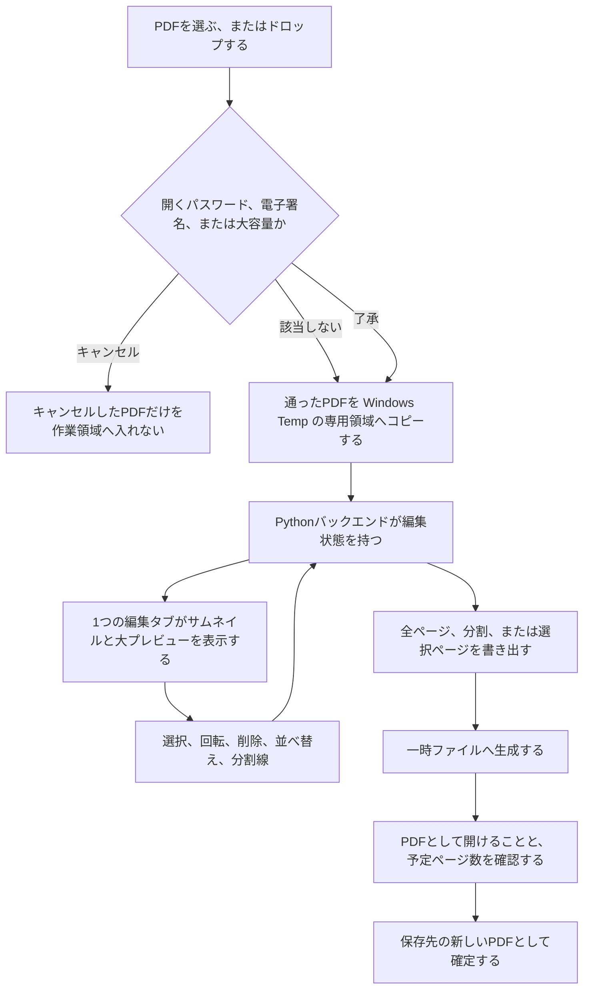
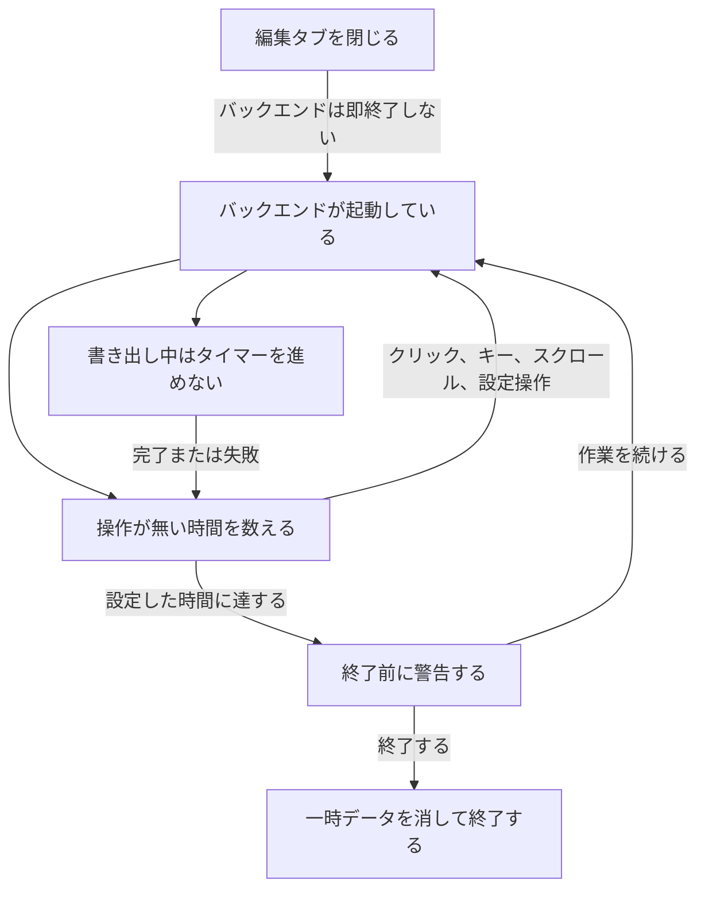

# PDF編集 全体アーキテクチャ

文書状態: 下書き

合意しているのは、ブラウザの Web UI、編集状態を持つ Python バックエンド、ローカルのファイルと Windows の接点、加工と表示のライブラリ、保存ダイアログの担い手、選択の置き場所、編集操作のコマンド API、Undo の 1 件の形、分割線と PDF の追加・取り除きのコマンド本文、フォルダ形式の 1 つの exe がバックエンドとトレイを兼ねることである。図は製品名の箱に分けていない。実装準備の完了を意味しない。

要求は [仕様](spec.md)、用語は [CONTEXT.md](../CONTEXT.md) に従う。

## 構成要素と役割

| 要素 | 役割 | 合意の状態 |
| --- | --- | --- |
| Web UI | サムネイル、大プレビュー、ツールバー、設定、ヘルプを、1 つの編集タブで表示する。操作をバックエンドへ送る。画面は Vite で組み立てた React（TypeScript）。ページの順番、削除、回転の正本は持たない。ページの描画は PDF.js | 役割と画面技術は合意。読み込み、表示、全ページ書き出し、選択、ズーム、回転、削除、並べ替え、Undo / Redo の画面は導入済み。ヘルプは未実装。理由は [ADR 0003](adr/0003-screen-uses-react.md) |
| Python バックエンド | 編集状態の正本を持つ。読み込み、書き出し、Undo / Redo、自動終了を行う。Web フレームワークは FastAPI。ページの加工は pikepdf | 言語、役割、フレームワーク、加工ライブラリは合意。読み込み、編集状態、全ページ書き出し、一時トークン、回転、削除、並べ替え、Undo / Redo は導入済み。自動終了は未実装 |
| セッションコピー | Windows Temp 配下の専用領域に、読み込んだ PDF のコピーを置く。以後の処理はこのコピーを使う。ブラウザは localhost から Range で読む | 合意。この縦切りでは導入済み |
| 保存先の新しい PDF | 元 PDF とは別のファイルとして確定する。保存ダイアログ、PDF を開く、保存先を開くはバックエンドが Windows へ依頼する。前回の保存先が無い、または使えないときの初期フォルダは、そのユーザーのドキュメントである | 合意。書き出しのコードは導入済み。実ダイアログの人手確認は未了。前回保存先の記憶はこの縦切りの対象外 |
| システムトレイ | 「開く」と「終了」を提供する。ログイン時の自動起動はしない。フォルダ形式の 1 つの exe が、バックエンドとトレイを同じプロセスで兼ねる。2 回目の起動は、既にあるプロセスに「開く」を渡す | 役割と方式は合意。未実装。理由は [ADR 0008](adr/0008-one-folder-exe-owns-tray.md) |

編集状態の正本はバックエンドにある。ブラウザは表示と操作の窓口である。元 PDF は変更せず、ロックもしない。

## 読み込みから書き出しまでの流れ

複数の PDF を一度に開いたときは、PDF ごとに分岐する。キャンセルした PDF だけが作業領域の外に残り、通った PDF だけがコピーされる。

利用制限付き PDF は、利用制限そのものでは確認せず、コピーへ進む。大容量は、1 つの PDF が 500 ページを超える、または 100MB（100 × 1024 × 1024 バイト）を超えるときである。ページ数は、開くパスワードの確認を終えたあとに数える。パスワード、電子署名、大容量の了承をキャンセルした PDF は `exclude` で終わる。コピーの途中で共有が切れたときも失敗とし、不完全なコピーを消して、自動では再開しない。

`copy` のあと、画面の PDF.js はセッションコピーを localhost から読む。`export` のページコピーは pikepdf が行う。保存ダイアログは `export` の前にバックエンドが出す。判断の理由は [ADR 0002](adr/0002-pikepdf-and-pdfjs.md) にある。

書き出しの検証に失敗したとき、またはユーザーがキャンセルしたときは、一時ファイルを可能な限り消し、編集状態は `state` に残る。検証を通過したときだけ `done` へ進む。全ページの書き出しが成功したときだけ、未保存の基準をその状態へ更新する。選択ページと分割では更新しない。成功後も編集状態そのものは残る。

分割線の位置の動きは [ADR 0001](adr/0001-split-line-follows-visible-position.md) に従う。削除では線の後ろのページを後ろのまとまりに残し、並べ替えでは線の位置番号を動かさず、ページが線をまたぐ。

## プロセスの生存

タブを閉じてもバックエンドは残る。操作が無い時間だけを数え、書き出し中はそのカウントを止め、完了または失敗のあとで再開する。

マウスを動かしただけでは `idle` は `run` に戻らない。システムトレイの「終了」とアプリ内の「終了」は `stop` へ進む。バックエンドが異常終了したあとの次回起動では、編集状態を復元せず、残った一時データを消して案内する。ブラウザだけが落ちたときは、バックエンドが生きていれば再接続して状態を戻す。

## 編集状態

ページが持つ項目は合意済みである。選択はページの項目ではなく、セッション上の識別子である。理由は [ADR 0006](adr/0006-selection-lives-in-session.md) にある。

- 追加単位は、識別子と元ファイル名を持つ。画面はフルパスを出さない。
- ページは、識別子、追加単位、元ページ番号（1 始まり）、現在の順、削除状態、回転（0 / 90 / 180 / 270 度）を持つ。
- 選択は `selected_page_ids`、アクティブページは `active_page_id` である。選択が 0 件のとき、アクティブページは無い。
- 書き出しは、削除されていないページを現在の順に pikepdf でコピーする。各ページの追加回転は、コピー先へ相対で足す。元 PDF の Rotate は置き換えない。
- 画面の React はこの記録を表示し、サムネイルとプレビューの更新をまとめる。順番、削除、回転、選択の正本にはしない。

API は次のとおりである。画面の HTML 以外は、起動時トークンの `Authorization: Bearer` を要求する。

- `POST /api/documents` で PDF のバイト列を 1 つ受け取り、追加単位の識別子を返す。この受け取りだけでは編集状態を変えない。作業領域へ入れるのは `append_documents` である。`GET /api/session` で編集状態を返す。`GET /api/session/file` でセッションコピーを Range 付きで返す。
- `POST /api/exports/all` で保存ダイアログのあと書き出しを始め、`GET /api/exports/{job_id}` で段階、処理ページ数、割合を返す。成功後に PDF と保存先を開くエンドポイントを持つ。
- `PATCH /api/session/selection` で選択とアクティブページを更新する。この更新だけでは Undo の履歴は増えない。
- 選択と表示の計画が置く設定の口は、`GET /api/settings` と `PUT /api/settings` である。本体は `thumbnail_layout`（`row` または `grid`）、`thumbnail_size`（`small`、`medium`、`large`）、`pane_ratio`（0 より大きく 1 未満の数、または null）である。トークンを要求する。読み込み中、ダイアログ中、書き出し中でも拒否しない。編集状態と Undo は変えない。
- `POST /api/session/commands` で、回転、削除、並べ替え、分割線、PDF の追加と取り除き、Undo、Redo を 1 リクエストずつ受け取る。成功時は更新後のセッションに `changed` と `history_dropped` を足して返し、失敗時は編集状態を変えない。理由は [ADR 0005](adr/0005-edit-commands-one-endpoint.md) にある。
- この縦切りで画面が送るのは `rotate`、`delete`、`reorder`、`undo`、`redo` である。`rotate` は `page_ids` と `direction`（`left` または `right`）を持つ。`delete` は `page_ids` を持つ。`reorder` は `page_ids` と、`before_page_id` または `after_page_id` の一方を持つ。`undo` と `redo` は追加の本文を持たない。
- 逆コマンド `restore_deleted` と `restore_order` は履歴の中だけにある。クライアントが送ると 400 である。
- 見えているページの現在の順は 1 からページ数までで、現在ページ番号と一致する。削除と並べ替えのあと付け直す。
- ページの `rotation` は、読み込み時 0 度からの追加回転であり、元 PDF の Rotate を置き換えない。画面は、PDF が元から持つ回転にこの追加回転を足して描く。
- セッションは `undo_enabled`、`redo_enabled`、`undo_hint`、`redo_hint` を持つ。`GET /api/session` はこれらを返し、`changed` と `history_dropped` は返さない。
- `set_split` と `clear_split` は `after_page_id` を 1 つ持つ。これは、見えている並びで分割線の直前にあるページである。`clear_all_splits` は識別子を持たない。その逆コマンドは、解除した直前ページを並べた `after_page_ids` を持つ 1 件の `set_split` である。画面から複数本を一度に入れる操作は無い。
- サーバが保持する分割線は、見えている並びの位置番号である。`after_page_id` は、リクエストを受けた時点の境目をその位置へ変換する。位置の動きは [ADR 0001](adr/0001-split-line-follows-visible-position.md) に従う。
- `append_documents` は `document_ids` を持つ。パスワード、電子署名、大容量、重複の確認を終えた追加単位だけを末尾へ入れる。作業領域が空の最初の読み込みも同じコマンドである。バイト列とパスは持たない。バイト列は `POST /api/documents` が先に受け取り、識別子だけを返す。確認が終わるまでは編集状態も履歴も変えない。キャンセルした追加は、このコマンドを送らない。
- 逆コマンド `remove_documents` は、同じ `document_ids` を持つ。ページの `delete` とは別である。バイト列を受け取る口は、このコマンドとは別であり、編集状態を変えない。
- 表示の記憶は `%LOCALAPPDATA%\pdf-editor\settings.json` である。選択と表示の計画で保存するのは、サムネイルの方式、サイズ、プレビューとサムネイルの領域比率である。理由は [ADR 0004](adr/0004-view-preferences-in-backend-file.md) にある。

Undo の 1 件は、その操作を打ち消す逆コマンドと、操作前の選択・アクティブページの識別子である。Redo の 1 件は、やり直す元のコマンドと、操作後の選択である。PDF のコピーは持たない。上限は 100 件である。理由は [ADR 0007](adr/0007-undo-record-is-inverse-command.md) にある。

読み込み、表示、全ページ書き出しの縦切りでは、成功した `POST /api/documents` は作業領域をその 1 件で置き換える。製品では、この受け取りは識別子を返すだけで編集状態を変えず、空の作業領域も編集途中も `append_documents` がページを入れる。この縦切りは、その分離をまだ持たない。選択、設定ファイル、回転、削除、並べ替え、Undo / Redo は、この縦切りの上に載っている。分割線と PDF の追加・取り除きのコマンドは、まだ画面から送らない。

## 接続とデータの扱い

- ブラウザとバックエンドの通信は localhost / 127.0.0.1 に限る。起動のたびに一時トークンを 1 つ作り、配信する HTML の meta 要素へ埋める。API は `Authorization: Bearer` を要求する。利用者はそのトークンを入力しない。プロセス終了で破棄する。トークンは同一 PC の他プロセスが HTML を読めば取得できる。他の PC からは待ち受けに届かない。編集タブを 1 つに制限する仕組みは、このトークンとは別であり、まだ無い。
- PDF の本文、サムネイル、ファイル名、パスワード、編集内容は外部へ送らない。更新確認だけが、ユーザーが押したときの外部通信になり得る。確認先は未決である。
- ページの実体の変更は書き出し時に行う。それまでは、前節の軽量な状態として持つ。Undo / Redo も、PDF 本体のコピーではなく、逆コマンドと選択の識別子を持つ。上限は 100 件である。
- 同一内容の判定に使うハッシュは、セッション中だけ保持する。同じ PDF の複数追加は追加単位ごとに独立し、一時コピーは共有する。
- 完成版の技術ログに、PDF 本文、パスワード、ファイル名、フルパス、共有サーバー名を含めない。30 日、または合計 10MB（10 × 1024 × 1024 バイト）を超えたときは、古いものから、両方の上限に収まるまで消す。開発者向け API ドキュメントは開発版だけで有効にする。
- 共有への保存も、一時ファイル、検証、リネームの順である。切断やリネーム失敗は保存失敗とし、自動では再送しない。

保存ダイアログ、エクスプローラで保存先を開く操作、PDF を開く操作は、バックエンドが Windows へ頼む。図の `done` は、確定したファイルがあることまでを示す。

## テストする接点

読み込み、表示、全ページ書き出しの自動テストは、`tests/test_auth.py`、`tests/test_session.py`、`tests/test_export.py` で、API、編集状態、セッションコピー、書き出しファイルの境界を確認する。回転、削除、並べ替え、Undo の自動テストも、同じ外側の API を境界にする。内部のファイル分割は、その境界を守る範囲の実装詳細である。合意済みの外側の境界は次のとおり。この縦切りが確認したのは、そのうち元 PDF を変えないこと、Temp のセッションコピー、書き出しの一時ファイルと最終ファイル、localhost の API である。

- ブラウザとバックエンドの localhost 境界。編集タブが 1 つであることと、2 つ目のタブが編集できないことを含む。
- ファイルシステム。元 PDF を変更しないこと、Temp のセッションコピー、書き出しの一時ファイルと最終ファイル、使えない保存先からドキュメント フォルダへ切り替えることを含む。
- ネットワーク共有。読み込み時のローカルコピーと、保存失敗時に再送しないことを含む。
- システムトレイの「開く」と「終了」。
- Windows 通知。バックグラウンド処理の完了と失敗。機密を含めない。

## 実装状況

2026-09-26 時点。読み込み、表示、全ページ書き出し、選択、ズームに加え、回転、削除、並べ替え、Undo / Redo を確認した。根拠はリポジトリルートの `python -m pytest`（64 件成功）、`web` の `npm run build`、ブラウザでの 6 ページ PDF である。ヘルプ、分割、トレイ、exe 化は未実装である。保存ダイアログを実際に 1 回開く人手確認は未了である。既定ブラウザを開く経路は、確認時にポート 8765 が使用中だったため未確認である。

| 要素 | 状況 | 根拠 |
| --- | --- | --- |
| Web UI | 回転、削除、並べ替え、Undo / Redo を確認 | ブラウザで、ツールバーの右回転と選択の維持、サムネイルの右回転が未選択ページだけを回すこと、サムネイル削除の「1ページを削除しました」と通知の元に戻す、ページ番号での移動、同じ位置の「並びは変わっていません」、8px 未満がクリックのままであること、挿入線、Esc でドラッグだけを取り消して選択が残ること、未選択ページのドラッグがその 1 ページだけを動かし選択すること、複数選択のドラッグが 1 回の Ctrl+Z で戻ること、横一列の左右と複数列の上下の自動スクロール、Ctrl+Z / Ctrl+Y、入力欄にフォーカスがある Ctrl+Z が Undo しないこと、選択 0 件の Delete と削除ボタンのツールチップ、全削除で書き出しが無効になることを確認した。以前の選択と表示の確認も残っている |
| Python バックエンド | コマンドと Undo を確認 | `python -m pytest` が 64 件成功した。回転、削除、並べ替え、Undo / Redo、不正コマンドの 400、処理中の 409、無変更の `changed: false`、101 件目の `history_dropped`、置き換え読み込み後の破棄フラグ、選択 PATCH が履歴を増やさないことを `tests/test_session.py` が確認した |
| セッションコピーと書き出し | 追加回転を確認 | テストが、元ファイル不変、元の Rotate 90 度にセッションの右回転を足した書き出し 180 度、見えているページが 0 枚のときの書き出し拒否を確認した。以前の縦切りの確認も残っている |
| 実保存ダイアログ | 未確認 | 自動テストはダイアログ関数を差し替える。Windows で実ダイアログを 1 回開き、ドキュメントが初期フォルダであり、保存まで完了する人手確認は残っている |
| システムトレイ | 未実装 | ランチャーのソースが無い |
| 用語と分割線の判断 | 文書として存在 | [CONTEXT.md](../CONTEXT.md)、[ADR 0001](adr/0001-split-line-follows-visible-position.md) |
| 画面技術の判断 | 文書として存在 | [ADR 0003](adr/0003-screen-uses-react.md) |

## 未決事項

更新確認先は [仕様の未決](spec.md#unresolved) に残している。この文書に残る未決は無い。
