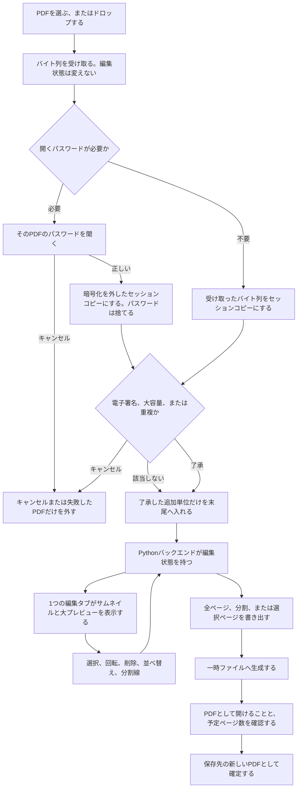
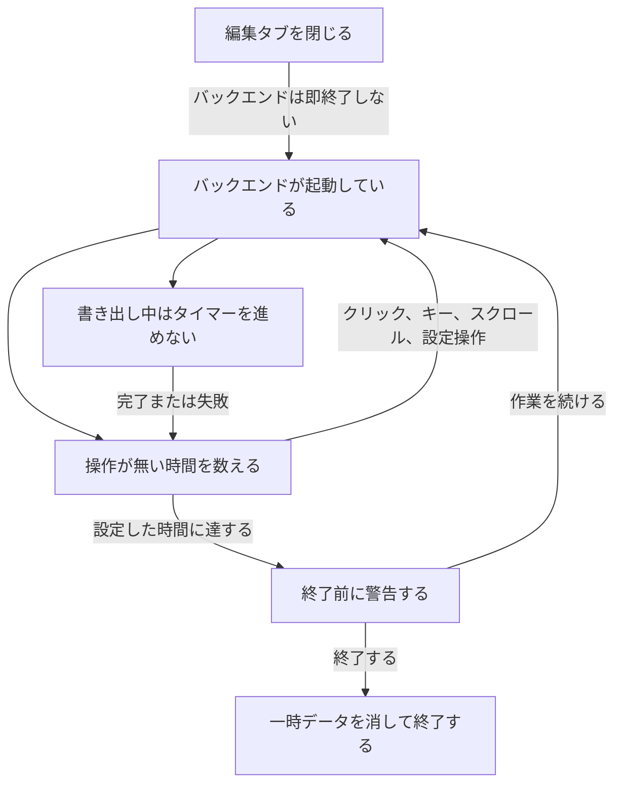

# PDF編集 全体アーキテクチャ

文書状態: 下書き

合意しているのは、ブラウザの Web UI、編集状態を持つ Python バックエンド、ローカルのファイルと Windows の接点、加工と表示のライブラリ、保存ダイアログの担い手、選択の置き場所、編集操作のコマンド API、Undo の 1 件の形、分割線と PDF の追加・取り除きのコマンド本文、フォルダ形式の 1 つの exe がバックエンドとトレイを兼ねることである。図は製品名の箱に分けていない。実装準備の完了を意味しない。

要求は [仕様](spec.md)、用語は [CONTEXT.md](../CONTEXT.md) に従う。

## 構成要素と役割

| 要素 | 役割 | 合意の状態 |
| --- | --- | --- |
| Web UI | サムネイル、大プレビュー、ツールバー、設定、ヘルプを、1 つの編集タブで表示する。操作をバックエンドへ送る。画面は Vite で組み立てた React（TypeScript）。ページの順番、削除、回転の正本は持たない。ページの描画は PDF.js | 役割と画面技術は合意。読み込み、表示、全ページ書き出し、選択、ズーム、回転、削除、並べ替え、Undo / Redo、末尾追加、ドラッグ＆ドロップ、未保存の表示、分割線、選択ページの書き出し、分割の書き出し、「分割設定 未出力」、「新しく始める」、設定、ヘルプ、テーマ、ツールバーの格納の画面は導入済み。編集タブを 1 つにすること、再接続、対応外ブラウザの案内、自動終了の警告、アプリ内の終了の画面は導入済み。理由は [ADR 0003](adr/0003-screen-uses-react.md) |
| Python バックエンド | 編集状態の正本を持つ。読み込み、書き出し、Undo / Redo、自動終了を行う。Web フレームワークは FastAPI。ページの加工は pikepdf | 言語、役割、フレームワーク、加工ライブラリは合意。読み込み、編集状態、全ページ書き出し、一時トークン、回転、削除、並べ替え、Undo / Redo、末尾追加、`unsaved`、分割線、選択ページの書き出し、分割の書き出し、`split_unexported`、`POST /api/session/reset`、設定の拡張、Windows のファイル選択、Windows 通知、編集権、無操作の計測、アプリ内の終了は導入済み。トレイのコードは導入済み。フォルダ形式の exe 設定はあるが、exe は組み立てていない |
| セッションコピー | Windows Temp 配下の専用領域に、読み込んだ PDF のコピーを置く。以後の処理はこのコピーを使う。ブラウザは localhost から Range で読む | 合意。この縦切りでは導入済み |
| 保存先の新しい PDF | 元 PDF とは別のファイルとして確定する。保存ダイアログ、PDF を開く、保存先を開くはバックエンドが Windows へ依頼する。前回の保存先が無い、または使えないときの初期フォルダは、そのユーザーのドキュメントである | 合意。書き出しのコードは導入済み。実ダイアログの人手確認は未了 |
| システムトレイ | 「開く」と「終了」を提供する。ログイン時の自動起動はしない。フォルダ形式の 1 つの exe が、バックエンドとトレイを同じプロセスで兼ねる。2 回目の起動は、既にあるプロセスに「開く」を渡す | 役割と方式は合意。トレイのコードは導入済み。exe は組み立てていない。理由は [ADR 0008](adr/0008-one-folder-exe-owns-tray.md) |

編集状態の正本はバックエンドにある。ブラウザは表示と操作の窓口である。元 PDF は変更せず、ロックもしない。

## 読み込みから書き出しまでの流れ

複数の PDF を一度に開いたときは、選択順またはドロップ順に 1 件ずつ確認する。受け取りは編集状態を変えない。キャンセルした PDF だけを外し、他は続ける。

利用制限付き PDF は、利用制限そのものでは確認せず、`plain` へ進む。電子署名の辞書があるときだけ `gate` で警告する。大容量は、1 つの PDF が 500 ページを超える、または 100MB（100 × 1024 × 1024 バイト）を超えるときである。ページ数は、開くパスワードの確認を終えたあとに数える。確認の順は、開くパスワード、電子署名、大容量、重複である。該当しない確認は飛ばす。パスワード、電子署名、大容量、重複の了承をキャンセルした PDF は `exclude` で終わる。開けない PDF も、そのファイルだけを `exclude` とする。コピーの途中で共有が切れたときも失敗とし、不完全なコピーを消して、自動では再開しない。

作業領域へ入ったセッションコピーを、画面の PDF.js が localhost から読む。開くパスワードを通した PDF は、暗号化を外したコピーであり、PDF.js にパスワードは渡さない。`export` のページコピーは pikepdf が行う。保存ダイアログは `export` の前にバックエンドが出す。判断の理由は [ADR 0002](adr/0002-pikepdf-and-pdfjs.md) にある。

書き出しの検証に失敗したとき、またはユーザーがキャンセルしたときは、一時ファイルを可能な限り消し、編集状態は `state` に残る。検証を通過したときだけ `done` へ進む。全ページの書き出しが成功したときだけ、未保存の基準をその状態へ更新する。選択ページと分割では更新しない。成功後も編集状態そのものは残る。

分割線の位置の動きは [ADR 0001](adr/0001-split-line-follows-visible-position.md) に従う。削除では線の後ろのページを後ろのまとまりに残し、並べ替えでは線の位置番号を動かさず、ページが線をまたぐ。

## プロセスの生存

タブを閉じてもバックエンドは残る。操作が無い時間だけを数え、書き出し中はそのカウントを止め、完了または失敗のあとで再開する。

マウスを動かしただけでは `idle` は `run` に戻らない。システムトレイの「終了」とアプリ内の「終了」は `stop` へ進む。バックエンドが異常終了したあとの次回起動では、編集状態を復元せず、残った一時データを消して案内する。ブラウザだけが落ちたときは、バックエンドが生きていれば再接続して状態を戻す。

## 編集状態

ページが持つ項目は合意済みである。選択はページの項目ではなく、セッション上の識別子である。理由は [ADR 0006](adr/0006-selection-lives-in-session.md) にある。

- 追加単位は、識別子と元ファイル名を持つ。画面はフルパスを出さない。
- ページは、識別子、追加単位、元ページ番号（1 始まり）、現在の順、削除状態、回転（0 / 90 / 180 / 270 度）を持つ。
- 選択は `selected_page_ids`、アクティブページは `active_page_id` である。選択が 0 件のとき、アクティブページは無い。
- 未保存は `unsaved` である。見えているページの追加単位、元ページ番号、回転、現在の順が、保存済みの基準と違うとき真である。分割線は含まない。基準は、追加単位が無い作業領域へ PDF を 1 件だけ入れたときと、全ページの書き出しが正常に終わったときに更新する。
- 分割設定 未出力は `split_unexported` である。見えている並びの分割線が、成功した分割の書き出しのまとまりにまだ反映されていないとき真である。分割線が無いときは偽である。成功した分割の書き出しだけが、そのときのページ識別子のまとまりを反映済みにする。どのページがどのまとまりに入るかを変える編集のあと、分割線が残っていれば再び真になる。回転はまとまりを変えない。選択ページと全ページの書き出しでは変えない。反映済みの比較は、まとまりごとのページ識別子の所属であり、まとまりの中の順は見ない。同じまとまりの中だけの並べ替えでは変えない。
- 書き出しは、削除されていないページを現在の順に pikepdf でコピーする。コピー元は、そのページの追加単位のセッションコピーである。各ページの追加回転は、コピー先へ相対で足す。元 PDF の Rotate は置き換えない。全ページの初期ファイル名は、見えているページが残っている追加単位のうち、最初に追加したもののファイル名に `_編集済み.pdf` を付ける。
- 画面の React はこの記録を表示し、サムネイルとプレビューの更新をまとめる。順番、削除、回転、選択の正本にはしない。

API は次のとおりである。画面の HTML 以外は、起動時トークンの `Authorization: Bearer` を要求する。

- `POST /api/documents` で PDF のバイト列を 1 つ受け取り、追加単位の識別子を返す。開くパスワードが必要な PDF も識別子を返す。この受け取りだけでは編集状態を変えない。受け取ったコピーは、`append_documents` まで編集状態の外に置く。キャンセルした受け取りは `POST /api/documents/discard` で消し、編集状態も履歴も変えない。作業領域へ入れるのは `append_documents` である。`GET /api/session` で編集状態を返す。この応答は `unsaved`、`split_positions`、`split_unexported` を含む。`GET /api/session/files/{document_id}` で、作業領域にあるその追加単位のセッションコピーを Range 付きで返す。パスワード未了の受け取りは返さない。
- `POST /api/exports/all` で保存ダイアログのあと書き出しを始め、`GET /api/exports/{job_id}` で段階、処理ページ数、割合を返す。成功後に PDF と保存先を開くエンドポイントを持つ。`POST /api/exports/selection` は、見えている並びのうち選択されたページだけを、同じ 1 ファイルの手順で書き出す。選択が 0 件のときは拒否する。`unsaved` と `split_unexported` は変えない。
- `POST /api/exports/split` はフォルダを 1 回選び、提案ファイル名を返す。このあいだはダイアログ中である。`POST /api/exports/split/confirm` は確定した名前で書き出しを始め、`POST /api/exports/split/cancel` は、分割の保留（フォルダ待ち、または名前待ち）があるときだけ、その保留を捨ててすぐダイアログを終える。フォルダ選択が後から戻っても、結果は捨てるだけで、そこではダイアログを終えない。全ページと選択ページの保存ダイアログは、分割の保留が無いので触らない。分割は、全部の一時ファイルを検証してから順に確定する。途中で失敗したときは、そのジョブの一時ファイルと、そのジョブが既に確定したファイルを可能な限り消す。完了した分割の `path` は null で、`files` に確定したパスを並べる。全ページと選択ページの完了応答は `path` の 1 本のままである。分割の `open-file` は `files` の添字で 1 件を開き、`open-folder` はフォルダを 1 回開く。
- `PATCH /api/session/selection` で選択とアクティブページを更新する。この更新だけでは Undo の履歴は増えない。
- `GET /api/settings` と `PUT /api/settings` の本体は、`thumbnail_layout`、`thumbnail_size`、`pane_ratio`、`theme`（`light`、`dark`、または null）、`windows_notifications`（真偽、初期値は真）、`idle_minutes`（30、60、120、240。初期値は 120）、`last_open_dir` と `last_save_dir`（パスまたは null）である。`GET` はすべて返す。ディスクに無いキーと、読んだ不正な値は、そのキーだけ既定値にする。通常の `PUT` の必須はフォルダ以外の 6 キーである。この 6 キーが欠けるとき、または値が範囲外のときは 400 とし、ファイルを変えない。`last_open_dir` と `last_save_dir` が本文にあっても 400 にせず書かず、ディスク上の値を残す。それ以外の未知キーは 400 である。`POST /api/settings/reset` はファイル全体を既定値へ戻す。トークンを要求する。編集権が無いタブからの `GET` と `PUT` は 409 である。編集権があるタブは、読み込み中、ダイアログ中、書き出し中でも拒否しない。編集状態と Undo は変えない。`theme` が null のあいだは、画面が `prefers-color-scheme` に合わせる。利用者が選んだあとだけ記憶し、以後は OS の色が変わっても追従しない。`idle_minutes` は保存し、自動終了の計測がこの値を読む。
- `POST /api/dialogs/open-pdfs` は、Windows の複数選択ダイアログを開き、選んだ順の `items` を返す。成功は `{ "status": "ok", "items" }`、キャンセルは `{ "status": "cancelled" }` である。開けた要素は、2 番目の受け取り結果に basename の `filename` を足す。開けなかった要素は `{ "filename", "detail" }` だけで、コピーは残さない。`try_begin(DIALOG)` の失敗は 409 で、`finish` は呼ばない。成功したあとは、キャンセル、成功、例外のすべてで `DIALOG` を終えてから応答する。例外は、その呼び出しで受け取った識別子を discard し、`last_open_dir` を変えない。ダイアログと受け取りのあいだは `DIALOG` で、そのあいだは `POST /api/documents` を 409 にする。`accept_upload` は `try_begin(LOADING)` するため呼ばない。活動を変えない取り込み本体で受け取る。受け取りは編集状態を変えない。`append_documents` は呼ばない。選んだフォルダを `last_open_dir` にする。ドラッグ＆ドロップはこのフォルダを更新しない。保存ダイアログと分割のフォルダ選択の初期フォルダは `last_save_dir` である。無い、または使えないときはドキュメントにし、応答の `initial_folder_notice` に「前回のフォルダが使えないため、ドキュメントを開きました。」を付ける。全ページと選択ページは、確定したファイルの親フォルダを `last_save_dir` にする。分割は、ジョブを始めたときに選んだフォルダそのものを `last_save_dir` にする。キャンセルでは更新しない。Windows のファイル選択で先にステージしたあとは、`POST /api/documents/{document_id}/duplicate` の `{ "approved_document_ids" }` で `duplicate` を取り直す。真になるのは、作業領域か、その配列の了承済み受け取りとハッシュが一致するときだけである。
- 書き出しジョブが完了または失敗に確定したとき、`windows_notifications` が真ならバックエンドが Windows 通知を出す。画面の進捗取得では出さない。本文は完了または失敗の定型文だけで、ファイル名、パス、パスワードは出さない。ダイアログのキャンセルは通知しない。技術ログは `%LOCALAPPDATA%\pdf-editor\logs` である。`POST /api/logs/open` がそのフォルダを開く。`GET /api/about` はアプリ名とバージョンを返す。「更新を確認」は、通信先が決まるまでは通信しない。`GET /settings` と `GET /help` は、`GET /` と同じ HTML を返す。
- `POST /api/session/commands` で、回転、削除、並べ替え、分割線、PDF の追加と取り除き、Undo、Redo を 1 リクエストずつ受け取る。成功時は更新後のセッションに `changed` と `history_dropped` を足して返し、失敗時は編集状態を変えない。理由は [ADR 0005](adr/0005-edit-commands-one-endpoint.md) にある。
- この縦切りで画面が送るのは `rotate`、`delete`、`reorder`、`append_documents`、`set_split`、`clear_split`、`clear_all_splits`、`undo`、`redo` である。`rotate` は `page_ids` と `direction`（`left` または `right`）を持つ。`delete` は `page_ids` を持つ。`reorder` は `page_ids` と、`before_page_id` または `after_page_id` の一方を持つ。`undo` と `redo` は追加の本文を持たない。`append_documents` は `document_ids` を持つ。
- 逆コマンド `restore_deleted`、`restore_order`、`remove_documents` は履歴の中だけにある。クライアントが送ると 400 である。
- 見えているページの現在の順は 1 からページ数までで、現在ページ番号と一致する。削除と並べ替えのあと付け直す。
- ページの `rotation` は、読み込み時 0 度からの追加回転であり、元 PDF の Rotate を置き換えない。画面は、PDF が元から持つ回転にこの追加回転を足して描く。
- セッションは `undo_enabled`、`redo_enabled`、`undo_hint`、`redo_hint`、`unsaved`、`split_positions`、`split_unexported` を持つ。`GET /api/session` はこれらを返し、`changed` と `history_dropped` は返さない。`split_positions` は、線の直前にあるページの 1 始まりの現在ページ番号を昇順に並べた配列である。
- `set_split` と `clear_split` は `after_page_id` を 1 つ持つ。これは、見えている並びで分割線の直前にあるページである。末尾のページは境目にできない。`clear_all_splits` は識別子を持たない。その逆コマンドは、解除した直前ページを並べた `after_page_ids` を持つ 1 件の `set_split` である。画面から複数本を一度に入れる操作は無く、クライアントが `after_page_ids` を送ると拒否する。
- サーバが保持する分割線は、見えている並びの位置番号である。`after_page_id` は、リクエストを受けた時点の境目をその位置へ変換する。位置の動きは [ADR 0001](adr/0001-split-line-follows-visible-position.md) に従う。削除と `remove_documents` は、外れるページより後ろの位置番号を詰め、空になる線と末尾の後ろの線を除き、同じ位置は 1 本にする。追加したページは最後のまとまりに入る。削除の逆コマンド `restore_deleted` は、外す前の位置番号を戻す。`remove_documents` の本文は位置を持たない。末尾追加の Undo 記録が、`remove_documents` 適用直前の位置番号を持ち、Redo の `append_documents` のあと書き戻す。並べ替えと末尾追加の適用そのものは、既存の位置番号を動かさない。
- `append_documents` は `document_ids` を持つ。パスワード、電子署名、大容量、重複の確認を終えた追加単位だけを末尾へ入れる。作業領域が空の最初の読み込みも同じコマンドである。バイト列、パス、パスワードは持たない。バイト列は `POST /api/documents` が先に受け取り、識別子を返す。確認が終わるまでは編集状態も履歴も変えない。キャンセルした追加は、このコマンドを送らない。パスワード未了の識別子を含むときは拒否し、編集状態もコピーも消さない。
- `POST /api/documents/{document_id}/password` は、開くパスワードが必要な受け取りにパスワードを渡す。正しいときは暗号化を外したセッションコピーへ置き換え、パスワードは残さない。ページ数と電子署名の有無がここで確定する。違うパスワードは拒否し、暗号化された受け取りは残す。編集状態は変えない。
- 逆コマンド `remove_documents` は、同じ `document_ids` を持つ。ページの `delete` とは別である。バイト列を受け取る口は、このコマンドとは別であり、編集状態を変えない。
- `POST /api/session/reset` は、作業領域、選択、履歴、分割線、未保存の基準、分割の反映済み、作業領域の外の受け取り、一時コピーを空に戻す。コマンドではなく、Undo の 1 件にしない。読み込み中、ダイアログ中、書き出し中は拒否し、何も消さない。確認の文言は画面が持つ。失われる状態は `unsaved` と `split_unexported` だけである。
- 表示の記憶は `%LOCALAPPDATA%\pdf-editor\settings.json` である。選択と表示の計画で保存するのは、サムネイルの方式、サイズ、プレビューとサムネイルの領域比率である。この縦切りでは、同じファイルにテーマ、Windows 通知、自動終了までの時間、前回の読み込みフォルダ、前回の保存フォルダも置く。理由は [ADR 0004](adr/0004-view-preferences-in-backend-file.md) にある。

Undo の 1 件は、その操作を打ち消す逆コマンドと、操作前の選択・アクティブページの識別子である。末尾追加の 1 件は、それに加えて、`remove_documents` を適用する直前の `split_positions` を記録が持つ。削除直前の位置は、逆コマンド `restore_deleted` が持つ。Redo の 1 件は、やり直す元のコマンドと、操作後の選択である。末尾追加の Redo は、ページを戻したあと、記録の `split_positions` を書き戻す。PDF のコピーは持たない。上限は 100 件である。理由は [ADR 0007](adr/0007-undo-record-is-inverse-command.md) にある。

読み込み、表示、全ページ書き出し、末尾追加、未保存、読み込み前の確認、分割線、選択ページと分割の書き出し、新しく始める、設定、ヘルプ、表示の縦切りでは、`POST /api/documents` は編集状態を変えず追加単位の識別子を返す。開くパスワードが必要な PDF も識別子を返す。作業領域へ入れるのは、確認を終えた追加単位の `append_documents` である。コピーの取得は `GET /api/session/files/{document_id}` であり、`GET /api/session/file` は無い。`unsaved` はセッションが返す。新しく始めるは `POST /api/session/reset` で作業領域を空にする。`Session.startup` とは別である。設定ファイルは、テーマ、Windows 通知、自動終了までの時間、前回の読み込みフォルダ、前回の保存フォルダを持つ。`POST /api/dialogs/open-pdfs`、`POST /api/documents/{document_id}/duplicate`、`POST /api/settings/reset`、`GET /api/about`、`POST /api/logs/open` がある。書き出しの完了と失敗は、設定がオンのときバックエンドが Windows 通知を出す。選択、設定、回転、削除、並べ替え、Undo / Redo、末尾追加、開くパスワード、電子署名、大容量、重複の確認、分割線、選択ページと分割の書き出し、新しく始める、テーマ、ヘルプは、この縦切りの上に載っている。トレイのコードとフォルダ形式の exe 設定はこの単位で入った。exe は組み立てていない。編集権と無操作の計測は前の単位で入った。

## 接続とデータの扱い

- ブラウザとバックエンドの通信は localhost / 127.0.0.1 に限る。起動のたびに一時トークンを 1 つ作り、配信する HTML の meta 要素へ埋める。API は `Authorization: Bearer` を要求する。利用者はそのトークンを入力しない。プロセス終了で破棄する。トークンは同一 PC の他プロセスが HTML を読めば取得できる。他の PC からは待ち受けに届かない。編集タブを 1 つに制限する仕組みは、このトークンとは別である。
- 編集権は `POST /api/editor/claim` の `tab_id` が持つ。画面の `/api/` は Bearer に加えヘッダ `X-Tab-Id` でタブを区別する。`claim`、`release`、`heartbeat` の本文は `{ "tab_id": "<識別子>" }` で、ヘッダと一致しないときは 400 である。同じ識別子は取り直せる。成功応答にセッションは含めず、編集状態は `GET /api/session` が返す。別の識別子が 5 秒以内に応答しているあいだ、後のタブの `/api/` は `claim`、`release`、`heartbeat`、`POST /api/editor/open` 以外を拒否する。拒否は `X-Tab-Id` の欠落か、保有中と違う識別子である。`POST /api/editor/open` は編集権の対象外で、Bearer だけで既定ブラウザを開く。画面は `pagehide` と F5 で `POST /api/editor/release` を送らない。編集権を手放すのは、保有中の `tab_id` の `POST /api/editor/heartbeat` が 5 秒途絶したときである。`release` は、その `tab_id` が持っているときだけ即時に手放す。保有中でない heartbeat は最終応答を更新しない。無操作の計測は `startup` の直後から `idle_minutes` で進み、`POST /api/activity` が最初からやり直す。残り 60 秒を切ると heartbeat 応答とセッション応答の `idle_warning` が真になる。`POST /api/shutdown` は一時データを消してプロセスを止める。`GET /api/about` の `cleared_leftover` は、起動時に前回の一時データが残っていたときだけ真である。
- 単一インスタンスは、名前付きミューテックス `Local\pdf-editor` で守る。トークンファイル `%LOCALAPPDATA%\pdf-editor\session.token` の中身は `app.state.token` と同じ値で、現在のユーザーだけが読める。終了時に消す。2 回目の起動とトレイの「開く」は、そのトークンで `POST /api/editor/open` を送り、成功したときだけ終了コード 0 で終わる。この要求は Bearer だけで、編集権は要らず、409 の対象外である。新しいバックエンドは作らない。トレイの「終了」は、未保存と分割設定 未出力が両方偽なら確認せず共通停止する。どちらかが真で編集権タブが無いときの確認は、Windows のメッセージボックスである。キャンセルは停止しない。実行は共通停止である。共通停止は `session.shutdown`、トークンファイルの削除、トレイの削除、`uvicorn.Server.should_exit` の順である。`main` は `uvicorn.Server` を保持する。編集権タブがあるときの確認は、heartbeat 応答とセッション応答の `exit_requested` で、実行の `POST /api/shutdown` も共通停止、キャンセルは `POST /api/session/exit-cancel` である。確認中に最終 heartbeat から 5 秒を超えたとき、または `release` のときは、この計画が `exit_requested` を偽に戻し、同じメッセージボックスへ進む。6 番目の claim 待ちには頼らない。画面は確認を閉じる。メッセージボックスはトレイの隠しウィンドウで出す。凍結時の画面は `sys._MEIPASS` 配下の `web/dist` である。凍結起動の `PDF_EDITOR_ENV` 未設定は `production` である。ログイン時の自動起動はしない。
- PDF の本文、サムネイル、ファイル名、パスワード、編集内容は外部へ送らない。更新確認だけが、ユーザーが押したときの外部通信になり得る。確認先は未決である。
- ページの実体の変更は書き出し時に行う。それまでは、前節の軽量な状態として持つ。Undo / Redo も、PDF 本体のコピーではなく、逆コマンドと選択の識別子を持つ。末尾追加の記録だけが、それに加えて `split_positions` を持つ。上限は 100 件である。
- 同一内容の判定に使うハッシュは、受け取ったバイト列の SHA-256 であり、セッション中だけ保持する。同じハッシュの追加単位は追加単位ごとに独立し、一時コピーを共有する。開くパスワードが必要な PDF のセッションコピーは、正しいパスワードで暗号化を外したファイルである。パスワードはログ、設定、メモリに残さない。
- 完成版の技術ログに、PDF 本文、パスワード、ファイル名、フルパス、共有サーバー名を含めない。30 日、または合計 10MB（10 × 1024 × 1024 バイト）を超えたときは、古いものから、両方の上限に収まるまで消す。開発者向け API ドキュメントは開発版だけで有効にする。
- 共有への保存も、一時ファイル、検証、リネームの順である。切断やリネーム失敗は保存失敗とし、自動では再送しない。

保存ダイアログ、エクスプローラで保存先を開く操作、PDF を開く操作は、バックエンドが Windows へ頼む。図の `done` は、確定したファイルがあることまでを示す。

## テストする接点

読み込み、表示、全ページ書き出しの自動テストは、`tests/test_auth.py`、`tests/test_session.py`、`tests/test_export.py` で、API、編集状態、セッションコピー、書き出しファイルの境界を確認する。回転、削除、並べ替え、Undo の自動テストも、同じ外側の API を境界にする。内部のファイル分割は、その境界を守る範囲の実装詳細である。合意済みの外側の境界は次のとおり。この縦切りが確認したのは、そのうち元 PDF を変えないこと、Temp のセッションコピー、書き出しの一時ファイルと最終ファイル、localhost の API である。

- ブラウザとバックエンドの localhost 境界。編集タブが 1 つであることと、2 つ目のタブが編集できないことを含む。
- ファイルシステム。元 PDF を変更しないこと、Temp のセッションコピー、書き出しの一時ファイルと最終ファイル、使えない保存先からドキュメント フォルダへ切り替えることを含む。
- ネットワーク共有。読み込み時のローカルコピーと、保存失敗時に再送しないことを含む。
- システムトレイの「開く」と「終了」。
- Windows 通知。バックグラウンド処理の完了と失敗。機密を含めない。

## 実装状況

2026-09-27 時点。読み込み、表示、全ページ書き出し、選択、ズーム、回転、削除、並べ替え、Undo / Redo、末尾追加、ドラッグ＆ドロップ、未保存の表示、開くパスワード、電子署名、大容量、重複の確認、同一内容の一時コピー共有に加え、分割線、選択ページの書き出し、分割の書き出し、「分割設定 未出力」、「新しく始める」、設定、ヘルプ、テーマ、ツールバーの格納、Windows のファイル選択、書き出し完了と失敗の Windows 通知を確認した。根拠はリポジトリルートの `.venv` の `python -m pytest`（140 件成功）、`web` の `npm run build`、ブラウザでの確認である。トレイは確認した。未保存だけの終了では「未保存の変更があります。破棄して新しく始めますか？」、分割設定 未出力だけでは「まだ書き出していない分割設定があります。破棄して新しく始めますか？」が heartbeat のあと出た。キャンセル後もページは残った。1 件の PDF だけで未保存でも分割設定 未出力でもないときは、その確認は出なかった。根拠は `.venv` の `python -m pytest`（184 件成功）と `web` の `npm run build` である。exe は組み立てていない。編集権、再接続、対応外ブラウザの案内、無操作の計測、アプリ内の終了は確認した。根拠は同じ `.venv` の `python -m pytest`（160 件成功）、`web` の `npm run build`、ブラウザでの確認である。2 つ目のタブは案内文だけになり、1 つ目の再読み込みでは `POST /api/editor/release` が飛ばず編集画面が戻った。1 つ目を閉じたあと、2 つ目が編集画面になった。Firefox のユーザーエージェントでは対応外の案内が出て、閉じても編集でき、再読み込みで案内が戻った。Chrome のユーザーエージェントでは案内は出なかった。警告は「操作が無いため、まもなく終了します。」で、未保存だけ、分割設定 未出力だけ、両方の文をそれぞれ確認した。「作業を続ける」で警告は消え、警告の「閉じる」のあとに `POST /api/activity` は飛ばなかった。「終了」は未保存と分割設定 未出力があるとき確認を出し、キャンセル後もページが残った。自動終了は 8 秒に差し替えた `python -m app` が確認ダイアログなしで終了コード 0 になった。その差し替えは製品の経路には残していない。計測の長さは `idle_minutes` だけである。設定の保存と、設定を初期状態に戻したあとに、画面は `POST /api/activity` の `source: settings` を送る。以前からの全ページ書き出しを、保存ダイアログで保存完了まで通す人手確認は未了である。この分割の確認では、保存ダイアログを 1 回開いてキャンセルし、選択ページの保存をドキュメントへ完了し、分割のフォルダ選択を 1 回開いて 2 ファイルの書き出しまで完了した。4 ページの分割は最初のジョブ取得時点で完了しており、進捗率・処理ページ数・段階の行は画面では読めなかった。表示そのものは画面のソースにあり、ジョブの段階は `tests/test_export.py` が確認している。既定ブラウザを開く経路は、以前の確認時にポート 8765 が使用中だったため未確認である。

| 要素 | 状況 | 根拠 |
| --- | --- | --- |
| Web UI | 新しく始めるを確認 | ブラウザで、PDF を 1 件読んだだけでは確認が出ずページとプレビューが空になること、回転後は「未保存の変更があります。破棄して新しく始めますか？」が出てキャンセルと Esc では回転と選択が残ること、Enter では破棄されないこと、「破棄して新しく始める」で空になること、分割線だけでは「まだ書き出していない分割設定があります。破棄して新しく始めますか？」が出ること、未保存と分割設定 未出力は 1 つの文になること、読み込み中・保存先の選択中・ファイル名の確定中は「新しく始める」が無効で理由がツールチップに出ること、分割の書き出し結果が出ているときに破棄すると結果が消えてプレビューが空になり表示設定は残ることを確認した。以前の読み込み前の確認、末尾追加、ドラッグ＆ドロップ、未保存、回転、削除、並べ替え、Undo、分割線の確認も残っている。今回のブラウザ確認では、設定とヘルプの往復とブラウザの戻る・進むでページ 4 の選択が残り、戻った直後は倍率 125% とプレビューのスクロール 28px も残った。`/settings` の再読み込み後も設定が開き、選んだダークのまま紙色は `#171512` だった。ダークのあと OS の色をライトにしても追従せず、初期化のあと `data-theme` が外れて OS のダークに紙色が追従した。初期化の確認は「設定を初期状態に戻しますか？」で、Enter では戻らず、Esc と「キャンセル」ではダークが残り、「初期状態に戻す」で OS の色に戻った。そのとき編集のページは 4 枚のままだった。幅 2400px ではアイコン付きボタンの文字だけが隠れ、幅 2000px では「新しく始める」が「元に戻す」より先に「...」へ入り、書き出し、ページ番号、ズームはバーに残った。ヘルプには基本操作、複数選択、分割、ショートカットがあり、検索欄は無く、図は CSS だった。「更新を確認」は fetch も XHR も出さず、「更新確認先はまだ決まっていません。」と出た。Windows 通知をオフにし、自動終了を 30 分にすると設定ファイルへ保存され、この画面に終了のタイマーは無かった。「PDF を選ぶ」で題名「PDF を選ぶ」のダイアログが開き、閉じたあともページ数と選択と `last_open_dir` は変わらなかった。壊れた PDF のドロップは開けない通知になり、`last_open_dir` は null のままだった |
| Python バックエンド | 読み込み前の確認とコピー共有を確認 | 読み込み前の確認時点の `.venv` の `python -m pytest` は 89 件成功だった。分割線と書き出しを含めたあと同じコマンドは 110 件成功した。新しく始めるを含めたあとは 120 件成功した。`POST /api/session/reset` は空のセッションを返し、読み込み中・ダイアログ中・書き出し中と reset の処理中は 409 で作業領域も一時コピーも消さない。パスワードが必要な PDF が識別子を返し編集状態を変えないこと、正しいパスワードで暗号化が外れ応答と一時ファイルにパスワードが無いこと、違うパスワードは受け取りを残すこと、パスワード未了の `append_documents` が 400 でコピーを残すこと、署名辞書は `signed: true`、利用制限だけでは `signed: false` であること、開くパスワード付き署名の初回応答は `signed: false` かつ `page_count` が null で、成功応答は `signed: true` とページ数であること、500 ページと 100MB ちょうどは大容量条件を満たさず 501 ページと 1 バイト超過は満たすこと、同じバイト列の 2 件目が `duplicate: true` で追加単位は 2 つセッションコピーは 1 つであること、暗号化バイト列も復号後に 1 つのコピーを共有すること、復号保存の失敗で暗号化受け取りと既存コピーが残ること、Undo で外れた同じバイト列は `duplicate: false` でコピーを共有すること、共有中の discard がファイルを消さないことを `tests/test_session.py` が確認した。以前の末尾追加と `unsaved` の確認も残っている。設定、ファイル選択、通知を含めたあとの `.venv` の `python -m pytest` は 140 件成功した。`PUT /api/settings` はフォルダキーを本文に含めてもディスクの `last_open_dir` と `last_save_dir` を消さない。`POST /api/settings/reset` は既定値を書き、編集状態を変えない。`POST /api/dialogs/open-pdfs` は選んだ順と basename の `filename` を返し、キャンセルと例外ではフォルダを更新せず、ダイアログ中の `POST /api/documents` は 409 になる。書き出しの完了と失敗だけが `show_notification` を呼び、進捗取得とダイアログのキャンセルでは呼ばない。通知オフでは呼ばない。`POST /api/logs/open` はフォルダを作ったあと、30 日より古いファイルと、合計 10MB を超える古いファイルを消してからそのフォルダを開く |
| セッションコピーと書き出し | 同一内容の共有コピーを確認 | テストが、同じハッシュの追加単位が 1 つの一時ファイルを共有し、一方の Undo 後ももう一方の取得が 200 であること、元ファイル不変、元の Rotate 90 度にセッションの右回転を足した書き出し 180 度、見えているページが 0 枚のときの書き出し拒否、複数の追加単位を現在順にコピーすること、成功後は `unsaved` が偽になり失敗とキャンセルでは真のままであることを確認した。以前の縦切りの確認も残っている |
| 実保存ダイアログ | 分割の確認では開いた。全ページの保存完了は未了 | 自動テストはダイアログ関数を差し替える。この分割の確認では、保存ダイアログを 1 回開いてキャンセルし、選択ページはドキュメントへ保存が完了し、分割のフォルダ選択を 1 回開いて書き出しまで完了した。以前からの全ページ書き出しを保存完了まで通す人手確認は残っている |
| 分割線と書き出し | 確認した | ブラウザで、サムネイル間と複数列の行またぎの線、削除後の線の残りと Undo、線をまたぐ並べ替え、「すべての分割線を解除」の 1 回の Undo、選択 0 件で選択ページが無効、見えている順の 2 ページだけが 1 PDF（高さ 120 のあと 100）、フォルダ 1 回と名前変更後の 2 PDF、各 PDF を開くと保存先を 1 回開く、「分割設定 未出力」の表示・成功後の消滅・線をまたぐと再表示、回転では出ない、線 0 本では出ない、見えているページ 0 枚で 3 種類が無効、名前入力の Esc と取り消し、再読み込み後の回転と線を確認した。`python -m pytest` は 110 件成功、`npm run build` は成功した |
| システムトレイ | 確認した。exe は未組み立て | ブラウザで、未保存だけと分割設定 未出力だけの終了確認、キャンセル後にページが残ること、両方が偽のときは確認が出ないことを確認した。`.venv` の `python -m pytest` は 184 件成功。隠しウィンドウの作成と削除は起動できた。exe はこの計画では組み立てていない |
| 用語と分割線の判断 | 文書として存在 | [CONTEXT.md](../CONTEXT.md)、[ADR 0001](adr/0001-split-line-follows-visible-position.md) |
| 画面技術の判断 | 文書として存在 | [ADR 0003](adr/0003-screen-uses-react.md) |

## 未決事項

更新確認先は [仕様の未決](spec.md#unresolved) に残している。この文書に残る未決は無い。
