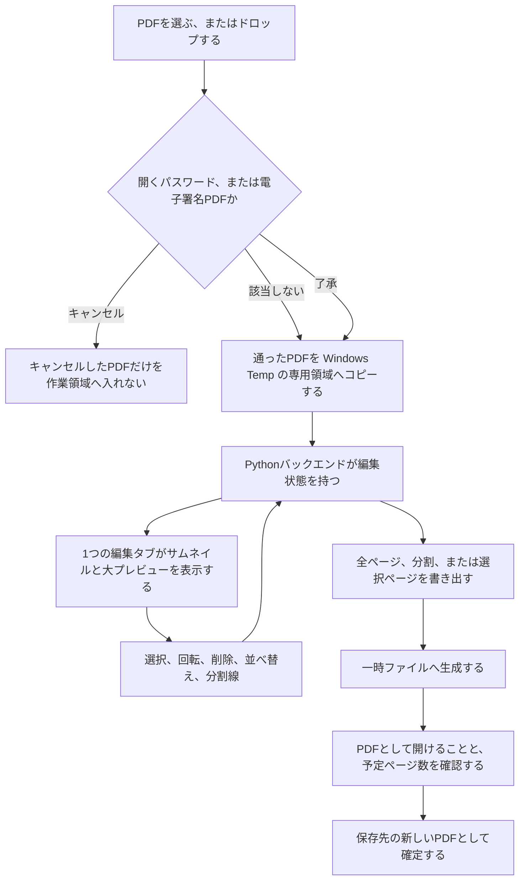
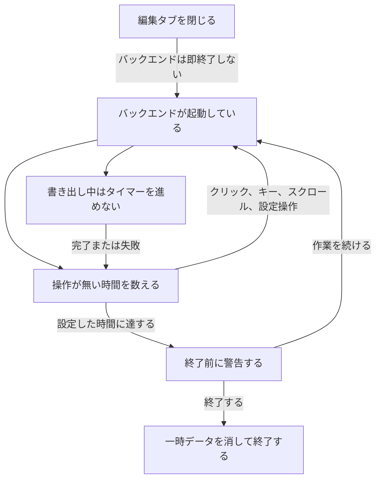

# PDF編集 全体アーキテクチャ

文書状態: 下書き

合意しているのは、ブラウザの Web UI、編集状態を持つ Python バックエンド、ローカルのファイルと Windows の接点までである。フレームワーク、ライブラリ、exe 化、OS ダイアログの担い手、編集状態の具体的なデータ構造は未決なので、図には描いていない。実装準備の完了を意味しない。

要求は [仕様](spec.md)、用語は [CONTEXT.md](../CONTEXT.md) に従う。

## 構成要素と役割

| 要素 | 役割 | 合意の状態 |
| --- | --- | --- |
| Web UI | サムネイル、大プレビュー、ツールバー、設定、ヘルプを、1 つの編集タブで表示する。操作をバックエンドへ送る | 役割は合意。画面技術は未選定 |
| Python バックエンド | 編集状態の正本を持つ。読み込み、書き出し、Undo / Redo、自動終了を行う | 言語と役割は合意。Web フレームワークは未選定 |
| セッションコピー | Windows Temp 配下の専用領域に、読み込んだ PDF のコピーを置く。以後の処理はこのコピーを使う | 合意 |
| 保存先の新しい PDF | 元 PDF とは別のファイルとして確定する。前回の保存先が無い、または使えないときの初期フォルダは、そのユーザーのドキュメントである | 合意。ダイアログを出す側は未決 |
| システムトレイ | 「開く」と「終了」を提供する。ログイン時の自動起動はしない | 役割は合意。実装方式は未選定 |

編集状態の正本はバックエンドにある。ブラウザは表示と操作の窓口である。元 PDF は変更せず、ロックもしない。

## 読み込みから書き出しまでの流れ

複数の PDF を一度に開いたときは、PDF ごとに分岐する。キャンセルした PDF だけが作業領域の外に残り、通った PDF だけがコピーされる。

利用制限付き PDF は、この確認には入らず、コピーへ進む。パスワードと電子署名の了承をキャンセルした PDF は `exclude` で終わる。コピーの途中で共有が切れたときも失敗とし、不完全なコピーを消して、自動では再開しない。

書き出しの検証に失敗したとき、またはユーザーがキャンセルしたときは、一時ファイルを可能な限り消し、編集状態は `state` に残る。検証を通過したときだけ `done` へ進む。全ページの書き出しが成功したときだけ、未保存の基準をその状態へ更新する。選択ページと分割では更新しない。成功後も編集状態そのものは残る。

分割線の位置の動きは [ADR 0001](adr/0001-split-line-follows-visible-position.md) に従う。削除では線の後ろのページを後ろのまとまりに残し、並べ替えでは線の位置番号を動かさず、ページが線をまたぐ。

## プロセスの生存

タブを閉じてもバックエンドは残る。操作が無い時間だけを数え、書き出し中はそのカウントを止め、完了または失敗のあとで再開する。

マウスを動かしただけでは `idle` は `run` に戻らない。システムトレイの「終了」とアプリ内の「終了」は `stop` へ進む。バックエンドが異常終了したあとの次回起動では、編集状態を復元せず、残った一時データを消して案内する。ブラウザだけが落ちたときは、バックエンドが生きていれば再接続して状態を戻す。

## 接続とデータの扱い

- ブラウザとバックエンドの通信は localhost / 127.0.0.1 に限る。起動のたびに一時的な認証情報を使い、正規の Web UI からの API 要求だけを受ける方向とする。利用者はその情報を入力しない。終了時に破棄する。認証の具体的な運び方は未決である。
- PDF の本文、サムネイル、ファイル名、パスワード、編集内容は外部へ送らない。更新確認だけが、ユーザーが押したときの外部通信になり得る。確認先は未決である。
- ページの実体の変更は書き出し時に行う。それまでは、識別子、元 PDF の追加単位、元ページ番号、現在順、削除、回転を軽量な状態として持つ。Undo / Redo も、PDF 本体のコピーではなく、逆操作に必要な軽量な情報を持つ。レコードの形は未決である。
- 同一内容の判定に使うハッシュは、セッション中だけ保持する。同じ PDF の複数追加は追加単位ごとに独立し、一時コピーは共有する。
- 完成版の技術ログに、PDF 本文、パスワード、ファイル名、フルパス、共有サーバー名を含めない。開発者向け API ドキュメントは開発版だけで有効にする。
- 共有への保存も、一時ファイル、検証、リネームの順である。切断やリネーム失敗は保存失敗とし、自動では再送しない。

保存ダイアログ、エクスプローラで保存先を開く操作、PDF を開く操作を、ブラウザとバックエンドのどちらが Windows へ頼むかは未決である。図の `done` は、確定したファイルがあることまでを示す。

## テストする接点

アプリのコードは無く、内部モジュールの seam は未合意である。合意済みの外側の境界は次のとおり。

- ブラウザとバックエンドの localhost 境界。編集タブが 1 つであることと、2 つ目のタブが編集できないことを含む。
- ファイルシステム。元 PDF を変更しないこと、Temp のセッションコピー、書き出しの一時ファイルと最終ファイル、使えない保存先からドキュメント フォルダへ切り替えることを含む。
- ネットワーク共有。読み込み時のローカルコピーと、保存失敗時に再送しないことを含む。
- システムトレイの「開く」と「終了」。
- Windows 通知。バックグラウンド処理の完了と失敗。機密を含めない。

## 実装状況

2026-09-25 時点で、アプリのソース、依存関係の設定ファイル、テストはリポジトリに無い。上の構成はすべて未実装である。存在するのは要求と用語と ADR だけである。

| 要素 | 状況 | 根拠 |
| --- | --- | --- |
| Web UI | 未実装 | 画面のソースが無い |
| Python バックエンド | 未実装 | サーバーと編集状態のソースが無い |
| セッションコピーと書き出し | 未実装 | ファイル操作のソースが無い |
| システムトレイ | 未実装 | ランチャーのソースが無い |
| 用語と分割線の判断 | 文書として存在 | [CONTEXT.md](../CONTEXT.md)、[ADR 0001](adr/0001-split-line-follows-visible-position.md) |

## 未決事項

影響範囲は [仕様の未決](spec.md#unresolved) と揃えている。

- Web フレームワーク、フロントエンド技術、PDF 処理ライブラリは未選定。図の `Pythonバックエンド` と `Web UI` を、特定の製品の箱に分けていない。参照: [技術スタック](tech-stack.md)。
- exe 化、ランチャー、トレイの実装方式は未選定。トレイの「開く」「終了」という役割だけを合意としている。
- OS の保存ダイアログと、「PDF を開く」「保存先を開く」の連携方式は未決。
- 編集状態と Undo の具体的なデータ構造、API の形、一時的な認証情報の運び方は未決。ページが持つ項目と、軽量な状態で持つことだけが合意済みである。
- 内部モジュールのテスト接点は未合意。
